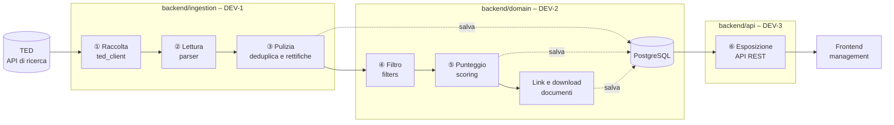
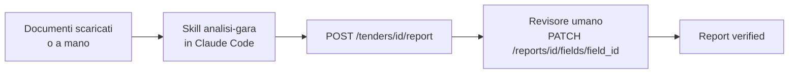

# Architettura – Radar Gare IT

> **Stato del documento: BOZZA – da approvare in T0.4 da tutti i dev.**
> Fonte: [docs/source/PIANO_BACKEND.md](source/PIANO_BACKEND.md), Parti 1 e 4 (T0.4).
> Dopo l'approvazione si modifica solo con una PR approvata da DEV-1, DEV-2 e DEV-3 (vedi [WORKFLOW.md](WORKFLOW.md)).

## 1. Flusso giornaliero

Ogni mattina alle 06:00 (Europe/Rome) il backend elabora le gare pubblicate su TED il giorno precedente.

Ramo manuale per le gare con punteggio alto (Fase 3 del piano):

Il backend **non contiene agenti LLM**: raccolta, filtri e punteggio sono codice tradizionale ([ADR-002](DECISIONS.md)).

## 2. Moduli

| Modulo | Responsabile | Cartella | Passi | Cosa espone agli altri moduli |
|---|---|---|---|---|
| Ingestion | DEV-1 | [`backend/ingestion/`](../backend/ingestion/CLAUDE.md) | ①②③ e scheduler | `fetch_notices(publication_date)` (T1.2), `parse_notice(raw)` (T1.3), `run_daily_ingestion(date)` (T1.5, usata da `POST /runs`) |
| Domain | DEV-2 | [`backend/domain/`](../backend/domain/CLAUDE.md) | ④⑤, documenti e report | modelli SQLAlchemy (T2.1); `repository.py` con `upsert_tender`, `list_tenders`, `get_tender` (T2.1); filtri (T2.2); `compute_score(tender)` (T2.3); gestione documenti (T2.4); `report_schema.json` e regole di verifica (T2.5) |
| API | DEV-3 | [`backend/api/`](../backend/api/CLAUDE.md) | ⑥, revisione umana, qualità e CI | endpoint REST definiti in `docs/API_CONTRACT.yaml` (T0.5) |

I moduli comunicano attraverso due accordi scritti:

1. **modello dati**: questo documento, sezione 3;
2. **contratto API**: `docs/API_CONTRACT.yaml`, creato da DEV-3 in T0.5.

## 3. Confini tra i moduli

| Regola | Motivazione |
|---|---|
| Solo `backend/domain/` accede direttamente al database; gli altri moduli usano le funzioni di `repository.py` | Lo schema cambia in un solo punto |
| `backend/ingestion/` chiama `domain` per salvare, filtrare e assegnare il punteggio | Le regole di business restano in `domain` |
| `backend/api/` chiama `domain` per leggere e `ingestion.run_daily_ingestion` per l'avvio manuale | L'API espone, non decide |
| `backend/domain/` non importa né `ingestion` né `api` | Evita dipendenze circolari |
| Si modifica il codice di un altro modulo solo con l'accordo del suo responsabile | Ogni modulo ha un solo proprietario |

## 4. Modello dati

Modello di partenza del piano (T0.4), **da validare nella riunione di T0.4**. I tipi sono una proposta; i campi segnati † dipendono da come TED fornisce i dati (vedi sezione 5).

### 4.1 `tenders` – una riga per gara

| Campo | Tipo proposto | Significato |
|---|---|---|
| `id` | integer, PK | Identificativo interno |
| `publication_number` † | string, univoco, indice | Numero di pubblicazione TED dell'avviso; chiave della deduplica (T1.4) |
| `title` † | text | Titolo della gara (italiano se presente, altrimenti inglese) |
| `description` † | text, null | Descrizione dell'oggetto |
| `buyer_name` † | string | Nome dell'ente appaltante |
| `buyer_city` † | string, null | Città dell'ente appaltante |
| `cpv_codes` † | lista di string (8 cifre) | Codici CPV dell'avviso, normalizzati a 8 cifre (T1.3) |
| `notice_type` † | string | Tipo di avviso (bando, preinformazione, rettifica, aggiudicazione…) |
| `estimated_value` † | decimal, null | Importo stimato; `null` se TED non lo fornisce |
| `currency` † | string (3), null | Valuta dell'importo, separata dal valore |
| `publication_date` | date, indice | Data di pubblicazione su TED |
| `submission_deadline` † | datetime con fuso, null, indice | Scadenza per la presentazione delle offerte |
| `ted_url` † | string | Link all'avviso su TED |
| `documents_url` † | string, null | Link ai documenti di gara indicato nell'avviso (usato in T2.4) |
| `relevance_score` | integer 1–5, null, indice | Voto di pertinenza calcolato in T2.3 |
| `is_relevant` | boolean | `true` se il voto supera la soglia configurabile (predefinita 3) |
| `discard_reason` | string, null | Motivo dello scarto da parte dei filtri (T2.2) |
| `parent_publication_number` † | string, null | Per una rettifica: `publication_number` dell'avviso originale (T1.4) |
| `raw_data` | JSON | Dato originale TED, per rielaborazioni future |
| `created_at` | datetime con fuso | Primo inserimento |
| `updated_at` | datetime con fuso | Ultimo aggiornamento (deduplica o rettifica) |

### 4.2 `documents` – documenti di una gara

| Campo | Tipo proposto | Significato |
|---|---|---|
| `id` | integer, PK | Identificativo interno |
| `tender_id` | integer, FK → `tenders.id` | Gara di appartenenza |
| `name` | string | Nome del documento (es. `Disciplinare.pdf`) |
| `url` | string, null | Link di origine |
| `status` | enum `downloaded` / `not_accessible` / `pending` | Esito del download (T2.4) |
| `local_path` | string, null | Percorso del file in `/data/documents/<publication_number>/` |
| `downloaded_at` | datetime con fuso, null | Momento del download |

### 4.3 `reports` – report generato con la Skill

| Campo | Tipo proposto | Significato |
|---|---|---|
| `id` | integer, PK | Identificativo interno |
| `tender_id` | integer, FK → `tenders.id` | Gara analizzata |
| `summary` | text | Sintesi esecutiva di 3–5 righe |
| `status` | enum `to_review` / `verified` | `verified` solo quando tutti i campi critici sono confermati (T2.5) |
| `generated_at` | datetime con fuso | Momento della generazione |
| `ai_label` | string | Etichetta di trasparenza: "Contenuto generato con IA – revisionato da [nome], [data]" |

### 4.4 `report_fields` – singolo campo di un report

| Campo | Tipo proposto | Significato |
|---|---|---|
| `id` | integer, PK | Identificativo interno |
| `report_id` | integer, FK → `reports.id` | Report di appartenenza |
| `label` | string | Nome del campo (es. "Scadenza offerte") |
| `value` | text | Valore attuale |
| `original_value` | text, null | Valore prodotto dalla Skill, conservato dopo una correzione (T3.4) |
| `source_doc` | string | Documento da cui è estratto il valore |
| `source_page` | integer, null | Pagina del documento |
| `is_critical` | boolean | Importi, fatturati, riferimenti normativi, requisiti legali o contrattuali |
| `verification_status` | enum (valori da definire) | "Da verificare" o "Verificato" |
| `reviewer` | string, null | Nome del revisore |
| `reviewed_at` | datetime con fuso, null | Momento della revisione |

### 4.5 `ingestion_runs` – storico delle esecuzioni

| Campo | Tipo proposto | Significato |
|---|---|---|
| `id` | integer, PK | Identificativo dell'esecuzione |
| `started_at` | datetime con fuso | Inizio |
| `finished_at` | datetime con fuso, null | Fine; `null` mentre è `running` |
| `status` | enum `running` / `success` / `failed` | Esito (T1.6) |
| `fetched_count` | integer | Avvisi raccolti da TED |
| `new_count` | integer | Gare nuove inserite |
| `updated_count` | integer | Gare aggiornate (deduplica o rettifica) |
| `relevant_count` | integer | Gare con `is_relevant = true` |
| `error_message` | text, null | Messaggio leggibile in caso di `failed` |

Indici previsti in T2.1: `publication_number` (univoco), `submission_deadline`, `relevance_score`, `publication_date`.

## 5. Domande aperte

### 5.1 Dipendono da TED – DA VERIFICARE in T1.1

Le risposte vanno in `docs/TED_API_NOTES.md` (T1.1). Fino ad allora **non si deducono** nomi di campi né sintassi delle query.

| # | Domanda | Campi o task interessati |
|---|---|---|
| Q1 | Endpoint di ricerca e necessità di una chiave API: DA VERIFICARE in T1.1 | `TED_API_URL`, T1.2 |
| Q2 | Come si filtra per Paese dell'ente = Italia: DA VERIFICARE in T1.1 | T1.2 |
| Q3 | Come si filtra per CPV, anche per prefisso (72\*, 48\*, 302\*, 324\*, 642\*): DA VERIFICARE in T1.1 | `cpv_codes`, T1.2 |
| Q4 | Come si filtra per data di pubblicazione: DA VERIFICARE in T1.1 | `publication_date`, T1.2 |
| Q5 | Come si distinguono bando, preinformazione, rettifica, aggiudicazione: DA VERIFICARE in T1.1 | `notice_type`, T2.2 |
| Q6 | Paginazione e numero massimo di risultati per pagina: DA VERIFICARE in T1.1 | T1.2 |
| Q7 | Limiti di richieste (rate limit): DA VERIFICARE in T1.1 | T1.2 |
| Q8 | In quali campi TED si trovano titolo, ente, importo, scadenza, link ai documenti: DA VERIFICARE in T1.1 | tutti i campi † |
| Q9 | Come si riconosce una rettifica e come si risale all'avviso originale: DA VERIFICARE in T1.1 | `parent_publication_number`, T1.4 |
| Q10 | Formato di `publication_number` e lingue disponibili per titolo e descrizione: DA VERIFICARE in T1.1 | `publication_number`, `title`, `description` |
| Q11 | Gare a più lotti: importo e scadenza per lotto o per gara: DA VERIFICARE in T1.1 | `estimated_value`, `submission_deadline` |

### 5.2 Da decidere tra i dev in T0.4

| # | Domanda | Note |
|---|---|---|
| D1 | In quale modulo vive lo schema `TenderCreate` restituito da `parse_notice` (T1.3)? | T1.3 (DEV-1) non dipende da T2.1 (DEV-2) |
| D2 | `cpv_codes`: array PostgreSQL o JSON? | I test usano SQLite, che non ha il tipo array |
| D3 | T1.5 esegue anche l'estrazione dei documenti (T2.4), ma la sua scheda non dipende da T2.4: aggiungere la dipendenza? | Piano, T1.5 passo 6 |
| D4 | Una gara può avere più report, o al massimo uno? | `GET /tenders/{id}/report` è al singolare |
| D5 | Valori ammessi di `verification_status` | Il piano usa le etichette "Da verificare" / "Verificato" |
| D6 | Come sa il job quali giorni sono stati elaborati, per recuperare quelli falliti (T1.5)? | `ingestion_runs` non ha un campo con la data elaborata |
| D7 | Le gare scartate dai filtri ricevono comunque un `relevance_score`? | T2.3: "ogni gara salvata ha un punteggio" |
