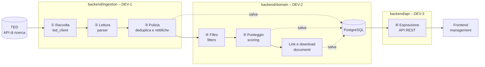
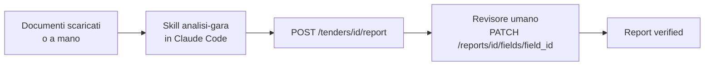

# Architettura – Radar Gare IT

> **Stato del documento: APPROVATO in T0.4** (versione 1.0, PR `setup/architecture`; approvazione = merge della PR).
> Fonte: [docs/source/PIANO_BACKEND.md](source/PIANO_BACKEND.md), Parti 1 e 4 (T0.4). Decisioni D1–D7 registrate in [DECISIONS.md](DECISIONS.md).
> Si modifica solo con una PR approvata da DEV-1, DEV-2 e DEV-3 (vedi [WORKFLOW.md](WORKFLOW.md)).

## 1. Flusso giornaliero

Ogni mattina alle 06:00 (Europe/Rome) il backend elabora le gare pubblicate su TED il giorno precedente.

Ramo manuale per le gare con punteggio alto (Fase 3 del piano):

Il backend **non contiene agenti LLM**: raccolta, filtri e punteggio sono codice tradizionale ([ADR-002](DECISIONS.md)).

## 2. Moduli

| Modulo | Responsabile | Cartella | Passi | Cosa espone agli altri moduli |
|---|---|---|---|---|
| Ingestion | DEV-1 | [`backend/ingestion/`](../backend/ingestion/CLAUDE.md) | ①②③ e scheduler | `fetch_notices(publication_date)` (T1.2), `parse_notice(raw) -> TenderCreate` (T1.3), `run_daily_ingestion(date)` (T1.5, usata da `POST /runs`) |
| Domain | DEV-2 | [`backend/domain/`](../backend/domain/CLAUDE.md) | ④⑤, documenti e report | modelli SQLAlchemy e schema Pydantic `TenderCreate` in `schemas.py` (T2.1, ADR-006); `repository.py` con `upsert_tender`, `list_tenders`, `get_tender` (T2.1); filtri (T2.2); `compute_score(tender)` (T2.3); gestione documenti (T2.4); `report_schema.json` e regole di verifica (T2.5) |
| API | DEV-3 | [`backend/api/`](../backend/api/CLAUDE.md) | ⑥, revisione umana, qualità e CI | endpoint REST definiti in `docs/API_CONTRACT.yaml` (T0.5) |

I moduli comunicano attraverso due accordi scritti:

1. **modello dati**: questo documento, sezione 3;
2. **contratto API**: `docs/API_CONTRACT.yaml`, creato da DEV-3 in T0.5.

## 3. Confini tra i moduli

| Regola | Motivazione |
|---|---|
| Solo `backend/domain/` accede direttamente al database; gli altri moduli usano le funzioni di `repository.py` | Lo schema cambia in un solo punto |
| `backend/ingestion/` chiama `domain` per salvare, filtrare e assegnare il punteggio | Le regole di business restano in `domain` |
| `backend/api/` chiama `domain` per leggere e `ingestion.run_daily_ingestion` per l'avvio manuale | L'API espone, non decide |
| `backend/domain/` non importa né `ingestion` né `api` | Evita dipendenze circolari |
| Si modifica il codice di un altro modulo solo con l'accordo del suo responsabile | Ogni modulo ha un solo proprietario |

## 4. Modello dati

Modello approvato in T0.4. I campi segnati † dipendono da come TED fornisce i dati: la mappatura campo TED → campo si definisce in T1.1 e T1.3 (vedi sezione 5).
I tipi sono portabili tra PostgreSQL e SQLite (test): niente tipi specifici di un solo database.

### 4.1 `tenders` – una riga per gara

| Campo | Tipo proposto | Significato |
|---|---|---|
| `id` | integer, PK | Identificativo interno |
| `publication_number` † | string, univoco, indice | Numero di pubblicazione TED dell'avviso; chiave della deduplica (T1.4) |
| `title` † | text | Titolo della gara (italiano se presente, altrimenti inglese) |
| `description` † | text, null | Descrizione dell'oggetto |
| `buyer_name` † | string | Nome dell'ente appaltante |
| `buyer_city` † | string, null | Città dell'ente appaltante |
| `cpv_codes` † | JSON: lista di string (8 cifre) | Codici CPV di gara e lotti, senza duplicati, normalizzati a 8 cifre (T1.3; ADR-007) |
| `notice_type` † | string | Tipo di avviso (bando, preinformazione, rettifica, aggiudicazione…) |
| `estimated_value` † | decimal, null | Importo stimato; `null` se TED non lo fornisce |
| `currency` † | string (3), null | Valuta dell'importo, separata dal valore |
| `publication_date` | date, indice | Data di pubblicazione su TED |
| `submission_deadline` † | datetime con fuso, null, indice | Scadenza per la presentazione delle offerte |
| `ted_url` † | string | Link all'avviso su TED |
| `documents_url` † | string, null | Link ai documenti di gara indicato nell'avviso (usato in T2.4) |
| `relevance_score` | integer 1–5, indice | Voto di pertinenza calcolato in T2.3 per **ogni** gara salvata, anche se scartata (ADR-010) |
| `is_relevant` | boolean | `true` solo se la gara non è scartata (`discard_reason` null) e il voto è ≥ soglia configurabile (predefinita 3) |
| `discard_reason` | string, null | Motivo dello scarto da parte dei filtri (T2.2) |
| `parent_publication_number` † | string, null | Per una rettifica: `publication_number` dell'avviso originale (T1.4) |
| `raw_data` | JSON | Dato originale TED, per rielaborazioni future |
| `created_at` | datetime con fuso | Primo inserimento |
| `updated_at` | datetime con fuso | Ultimo aggiornamento (deduplica o rettifica) |

### 4.2 `documents` – documenti di una gara

| Campo | Tipo proposto | Significato |
|---|---|---|
| `id` | integer, PK | Identificativo interno |
| `tender_id` | integer, FK → `tenders.id` | Gara di appartenenza |
| `name` | string | Nome del documento (es. `Disciplinare.pdf`) |
| `url` | string, null | Link di origine |
| `status` | enum `downloaded` / `not_accessible` / `pending` | Esito del download (T2.4) |
| `local_path` | string, null | Percorso del file in `/data/documents/<publication_number>/` |
| `downloaded_at` | datetime con fuso, null | Momento del download |

### 4.3 `reports` – report generato con la Skill

| Campo | Tipo proposto | Significato |
|---|---|---|
| `id` | integer, PK | Identificativo interno |
| `tender_id` | integer, FK → `tenders.id`, **univoco** | Gara analizzata: al massimo un report per gara (ADR-008) |
| `summary` | text | Sintesi esecutiva di 3–5 righe |
| `status` | enum `to_review` / `verified` | `verified` solo quando tutti i campi critici sono confermati (T2.5) |
| `generated_at` | datetime con fuso | Momento della generazione |
| `ai_label` | string | Etichetta di trasparenza: "Contenuto generato con IA – revisionato da [nome], [data]" |

### 4.4 `report_fields` – singolo campo di un report

| Campo | Tipo proposto | Significato |
|---|---|---|
| `id` | integer, PK | Identificativo interno |
| `report_id` | integer, FK → `reports.id` | Report di appartenenza |
| `label` | string | Nome del campo (es. "Scadenza offerte") |
| `value` | text | Valore attuale |
| `original_value` | text, null | Valore prodotto dalla Skill, conservato dopo una correzione (T3.4) |
| `source_doc` | string | Documento da cui è estratto il valore |
| `source_page` | integer, null | Pagina del documento |
| `is_critical` | boolean | Importi, fatturati, riferimenti normativi, requisiti legali o contrattuali |
| `verification_status` | enum `to_verify` / `verified` | Ogni campo nasce `to_verify` (etichetta UI "Da verificare"); diventa `verified` ("Verificato") con `confirm` o `correct` (T3.4). Lo stato del report dipende solo dai campi critici |
| `reviewer` | string, null | Nome del revisore |
| `reviewed_at` | datetime con fuso, null | Momento della revisione |

### 4.5 `ingestion_runs` – storico delle esecuzioni

| Campo | Tipo proposto | Significato |
|---|---|---|
| `id` | integer, PK | Identificativo dell'esecuzione |
| `run_date` | date, indice | Giorno di pubblicazione TED elaborato; serve al recupero dei giorni falliti (ADR-009) |
| `started_at` | datetime con fuso | Inizio |
| `finished_at` | datetime con fuso, null | Fine; `null` mentre è `running` |
| `status` | enum `running` / `success` / `failed` | Esito (T1.6) |
| `fetched_count` | integer | Avvisi raccolti da TED |
| `new_count` | integer | Gare nuove inserite |
| `updated_count` | integer | Gare aggiornate (deduplica o rettifica) |
| `relevant_count` | integer | Gare con `is_relevant = true` |
| `error_message` | text, null | Messaggio leggibile in caso di `failed` |

Indici previsti in T2.1: `publication_number` (univoco), `submission_deadline`, `relevance_score`, `publication_date`, `reports.tender_id` (univoco), `ingestion_runs.run_date`.

## 5. Domande aperte e decisioni

### 5.1 Dipendono da TED – DA VERIFICARE in T1.1

Prima sintesi del subagent `ted-api-researcher` (2026-10-14), **solo dalla documentazione, senza chiamate reali**.
È un punto di partenza per T1.1, non una specifica: nomi di campo e sintassi si confermano in T1.1 con risposte reali
salvate in `backend/tests/fixtures/` e si scrivono in `docs/TED_API_NOTES.md`. Fino ad allora nessun modulo li usa nel codice.

| # | Domanda | Indicazione dalla documentazione | Stato |
|---|---|---|---|
| Q1 | Endpoint e chiave API | `POST https://api.ted.europa.eu/v3/notices/search`; per la ricerca la chiave non è richiesta | DA VERIFICARE in T1.1 |
| Q2 | Filtro Paese = Italia | campo `buyer-country`; valore `ITA` coerente con gli esempi ma non citato | DA VERIFICARE in T1.1 |
| Q3 | Filtro CPV per prefisso | `classification-cpv = 72*` (wildcard finale), riferito a procedura e lotti | DA VERIFICARE in T1.1 |
| Q4 | Filtro data di pubblicazione | `publication-date` (alias `PD`), formato `YYYYMMDD` | DA VERIFICARE in T1.1 |
| Q5 | Tipi di avviso | campo `notice-type`: bandi `cn-*`, preinformazione `pin-*`, aggiudicazione `can-*`; la rettifica **non** ha un codice proprio; gli avvisi pre-eForms usano altri codici | DA VERIFICARE in T1.1 |
| Q6 | Paginazione | `page` e `limit`: massimo 250 per pagina, 15.000 per query; in alternativa `paginationMode = ITERATION` senza limite totale | DA VERIFICARE in T1.1 |
| Q7 | Rate limit | indicazioni di "fair usage" (es. 700 richieste/minuto), limite preciso della ricerca non trovato | DA VERIFICARE in T1.1 |
| Q8 | Campi di titolo, ente, importo, scadenza, documenti | candidati: `notice-title`, `buyer-name`, `buyer-city`, `estimated-value-glo`/`-lot`, `deadline`/`deadline-date-lot`, `document-url-lot`; scelta del campo giusto non chiara | DA VERIFICARE in T1.1 |
| Q9 | Rettifiche e avviso originale | campi `change-*` e `notice-version`; collegamento probabile tramite `procedure-identifier` | DA VERIFICARE in T1.1 |
| Q10 | Formato di `publication_number` e lingue | esempi `228503-2024`, `00177486-2024`; testi multilingua indicizzati per lingua | DA VERIFICARE in T1.1 |
| Q11 | Lotti | ogni avviso eForms ha almeno un lotto; importo e scadenza esistono sia per lotto sia a livello globale | DA VERIFICARE in T1.1 |

Fonti principali: [docs.ted.europa.eu/api](https://docs.ted.europa.eu/api/latest/search.html),
[field list](https://docs.ted.europa.eu/ODS/latest/reuse/field-list.html),
[codelist notice-type](https://docs.ted.europa.eu/eforms/latest/reference/code-lists/notice-type.html),
[guida alla ricerca esperta](https://ted.europa.eu/help/search-browse#expert-search).

**Conseguenza per il modello:** per Q8, Q9 e Q11 la regola di aggregazione dei lotti (quale importo e quale scadenza
salvare in `tenders`) si decide in T1.3 dopo le fixture reali e si documenta in `backend/ingestion/CLAUDE.md`.
Il modello resta a una riga per gara.

### 5.2 Decisioni prese in T0.4

| # | Domanda | Decisione | Dove |
|---|---|---|---|
| D1 | Dove vive `TenderCreate`? | Schema Pydantic in `backend/domain/schemas.py`, creato da DEV-2 in T2.1; `ingestion` lo importa. T1.3 dipende quindi anche da T2.1 | ADR-006, [TASKS.md](TASKS.md) |
| D2 | `cpv_codes`: array o JSON? | Colonna JSON con lista di string: funziona su PostgreSQL e SQLite. Il filtro `cpv` per prefisso si implementa in `list_tenders` (T2.1) con test su entrambi i database | ADR-007 |
| D3 | T1.5 dipende da T2.4? | Sì: il job chiama l'estrazione dei documenti. Dipendenza aggiunta | [TASKS.md](TASKS.md) |
| D4 | Quanti report per gara? | Al massimo uno (`reports.tender_id` univoco). `POST /tenders/{id}/report` su una gara che ha già un report risponde `409`. Dopo una rettifica il report esistente torna `to_review` (T1.4) | ADR-008 |
| D5 | Valori di `verification_status` | `to_verify` / `verified` (etichette UI "Da verificare" / "Verificato") | sezione 4.4 |
| D6 | Come si recuperano i giorni falliti? | Nuovo campo `ingestion_runs.run_date`. Il job elabora ogni giorno, dall'ultimo `run_date` con esito `success` fino a ieri, che non ha un'esecuzione `success` | ADR-009 |
| D7 | Le gare scartate hanno un punteggio? | Sì: punteggio per ogni gara salvata; `is_relevant` è `true` solo se la gara non è scartata e il voto è ≥ soglia | ADR-010 |
